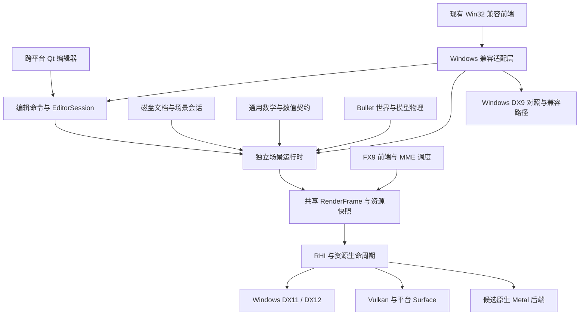

# MikuDanceStudio 跨平台移植计划

更新时间：2026-11-01。初始审计基线：`next@ef89b0b`，已合入 `main@35d99c7`（v10.15）。

实施状态：**P0 已完成**。三平台基础构建、两轮精确文件／数值回归、统一 Bullet 包装与分配／销毁验证、macOS 无窗口 Vulkan 探测均已执行；Windows x64／x86 编辑器构建通过。能力表、最低环境决策、依赖图、证据和仍未覆盖的范围见 [P0 实施与验收记录](docs/CROSS_PLATFORM_P0.md)。

**P1 已完成并复核**：独立数学层、不可变模型资源／实例和生成 PMX＋VMD 的骨骼／顶点 Morph／BDEF 链路已在三平台实际执行；无窗口 CLI 的依赖审计和 Windows 原有 CPU 对照通过。复核修正了逆矩阵的奇异判定及浮点结果残差检查，保留原数值基准。具体子集、数值契约、命令和证据见 [P1 实施与验收记录](docs/CROSS_PLATFORM_P1.md)。

**P2 已完成**：独立 CPU 场景运行时已接通 PMD／PMX、CP932、IK／SDEF／Morph、统一物理调度、静态 `.x` 附件及 PMM 会话。三平台同一公开生成场景门禁、Windows x64／x86 原生 CPU 对照和本地 Sour Miku 的动画、生命周期及 PMM 保存重载验收均通过。支持范围和真实模型动态 D3DX 数值差异单独记录在 [P2 实施与验收记录](docs/CROSS_PLATFORM_P2.md)。下一阶段为 P3；macOS／Linux 完整编辑器尚未交付。

本文是后续实施与验收计划。除“当前状态”明确列出的能力外，目标模块、接口、构建选项和里程碑均为规划，不代表已经实现。现有三平台 CI 配置也不代表完整编辑器已在三平台构建或运行通过。

## 1. 目标与交付范围

目标是在 Windows、macOS、Linux 上提供原生桌面编辑器，共用文件格式、场景运行时、编辑操作、渲染帧描述和 MME 执行语义。Windows 继续作为原版 MMD v9.32 的主要行为对照环境。

交付分为三个能力等级，分别记录验证结果：

| 等级 | 必须具备的能力 | 不应据此宣称的能力 |
|---|---|---|
| C1：基础编辑器 | PMD／PMX、VMD／VPD、PMM 读写；动画、IK、Morph、物理；选择与变换、时间轴、关键帧、撤销重做；基础材质、自阴影、音频同步；离屏图像序列导出 | 任意 MME、完整 Ray、Windows 二进制插件跨平台兼容 |
| C2：受支持 MME | 从原始 `.fx` 源码进入共享流程；已声明子集的参数、脚本、共享目标、多 Pass、MRT／HDR、mip；同一效果在目标平台通过对应门禁 | 未纳入能力表的 FX9 语法、脚本和渲染特性 |
| C3：扩大效果兼容 | 完整 Ray 执行链及后续真实效果逐项通过；兼容报告能定位源码、参数、资源或执行阶段的缺口 | 所有历史效果和任意原生 DLL 插件均已兼容 |

C1 可先交付，已完成的 C2 效果可以随版本启用；完整 Ray 不作为启动基础编辑器的前置条件。每个发行版应列出实际达到的等级与限制。

首批架构优先级：

| 平台／架构 | 角色 | 渲染路线 | 发布前需固定的条件 |
|---|---|---|---|
| Windows x64 | 主要产品与兼容对照平台 | DX11／DX12／Vulkan；保留 DX9 兼容路径 | 最低系统版本、驱动和运行库 |
| macOS arm64 | 首批 macOS 产品平台 | 首先验证 Vulkan 到 Metal 的实现；必要时增加原生 Metal 后端 | 最低 macOS、Vulkan 实现、所需 Metal／GPU 能力 |
| Linux x86_64 | 首批 Linux 产品平台 | Vulkan；覆盖 Wayland 与 X11 | 发行版／glibc 基线、最低驱动和桌面环境 |
| Windows x86 | 保留现有兼容与重建验证 | 现有 Windows 路径 | 不要求新跨平台 UI 同时支持 x86 |
| macOS Intel、Linux arm64 | 后续扩展候选 | 按设备能力验证 | 单独建立构建、运行和发布证据后承诺支持 |

最低系统版本和候选后端在 P0 固定，不能仅以开发机可运行为发布标准。跨平台原生运行不以 Wine 或 Windows 虚拟机为依赖。

## 2. 当前状态与主要缺口

以下结论来自当前代码与仓库配置；历史验证范围以对应文档为准。

| 模块 | 当前可复用基础 | 主要缺口／行动 |
|---|---|---|
| 文件与场景文档 | `mikudancestudio_formats` 已包含磁盘文档、场景会话、轨道求值及保存逻辑；独立运行时已接入，CP932／UTF-16LE 有显式解码边界 | 新增编辑轨道的序列化、Save As 路径改写及共享编辑命令继续按 P4 推进 |
| CPU 模型与场景 | `mikudancestudio_model_runtime` 和 `mikudancestudio_scene_runtime` 已独立跨平台；Windows 兼容宿主与新宿主共用骨骼、时间轴、Morph、蒙皮及物理算法核 | 原生 `RuntimeCpuModel::Impl` 保留行为对照所需的 `MMDApp`／原版布局；P3 将新运行时快照接入共享渲染流程 |
| 物理 | 模型刚体／关节创建、骨骼同步及统一场景调度已提取；Bullet 包装、分配及析构契约已统一 | 继续跟踪真实模型与旧 D3DX 数学路径的动态数值差异，不提高已有门槛 |
| 数学 | `mikudancestudio_cpu_math` 提供独立矩阵／四元数及检查型逆矩阵；D3DX 对照和跨平台数值门禁已通过 | D3DX 留在 Windows 兼容适配器；新功能继续沿用明确的运算顺序和误差契约 |
| RHI | Null、资源生命周期、通用 VS／PS、16 个纹理／采样器槽、MRT／HDR、共享目标、自阴影和后处理 | DX11／DX12 为 Windows 后端；Vulkan 的跨平台呈现与运行时着色器编译尚未接齐 |
| Vulkan | 已有设备、资源、Pass、SPIR-V、回读和 Windows 呈现 | `ValidSurface` 在非 Windows 返回失败；非 Windows 加载器只查找 `libvulkan.so.1`；缺少 macOS、Wayland、X11 的完整接入 |
| 着色器工具链 | 内置 SPIR-V 可在构建时生成；已有现代 HLSL 和反射契约 | `rhi_shader_spirv.hpp` 的运行时编译仅实现 Windows 路径，非 Windows 返回不可用 |
| MME | 已有有限 FX9 源码导入、共享参数、场景脚本、子效果、共享目标和 MRT／HDR 链路 | `portable_effect.cpp` 仍使用 D3DX、D3DCompiler、COM；加载、参数池和 SAS 描述仍依赖原生效果对象 |
| 编辑器 | Win32 界面、播放和编辑操作已具备行为对照 | 控件消息、应用状态、编辑操作和窗口句柄耦合，需要共享命令层与跨平台前端 |
| 系统与媒体 | Windows 路径、字体、音频、背景视频和导出实现可作为行为参考 | 需要独立的系统服务与媒体接口，替换非 Windows 上不存在的 API |
| 构建与 CI | 已覆盖三系统的格式、数学、模型／场景 CPU 运行时及依赖审计，Windows 保留 x64／x86 对照 | 跨平台窗口呈现、编辑器和发布包按 P3 及后续阶段补齐 |

当前完整 Ray 仍使用 DX9 回退；已通过的 Ray MaterialMap 子效果不代表根效果、光照、子效果链和最终合成已全部支持。具体范围见 [Ray 材质记录](docs/RHI_MME_RAY_MATERIAL.md)。

初始审计发现一项构建漂移：`cmake/cpu-simulation-tests/CMakeLists.txt` 设置 `/Zc:alignedNew-`，且直接使用上游历史 CMake；主工程和 Bullet 配方使用 `/Zc:alignedNew` 与外部构建包装。P0 已统一包装、C++17 及其公共使用要求，并重新执行三平台分配／销毁测试；结果见实施记录，不能仅把工作流配置视为验证。

## 3. 目标架构与依赖规则



目标模块划分如下。新名称用于表达职责，实施时可以沿用已有合适名称，避免机械重命名。

| 模块 | 责任 | 依赖约束 |
|---|---|---|
| `formats` | 文件解析、磁盘文档、字节级保存 | 不依赖 UI、GPU、Windows SDK、原版运行时布局 |
| `math` | 矩阵、四元数、几何、插值与必要的数值策略 | 不依赖 D3DX DLL；原版特定实现留在独立兼容适配器 |
| `scene_runtime` | 模型、姿态、IK、Morph、蒙皮、物理调度、资源修订 | 不依赖 `MMDApp`、窗口、D3D／COM 类型 |
| `editor_core` | 选择、编辑命令、撤销重做、播放状态、会话管理 | 调用运行时；通过事件／快照通知界面 |
| `render_scene` | 从当前 CPU 状态构建有序绘制、Pass 和资源快照 | 不调用旧 DX9 绘制，也不重复推进动画或物理 |
| `mme_frontend`／`mme_runtime` | FX9 描述、参数、语义、技术选择、脚本与资源依赖 | 不要求成功创建 `ID3DXEffect`，不依赖 GUI |
| `shader_compiler` | 现代 HLSL 编译、反射、缓存、诊断 | 后端编译器实现可替换，公共接口不暴露 COM |
| `rhi`／各 GPU 后端 | 设备、管线、资源、同步、呈现和回读 | 接受显式能力与平台 Surface，不查询编辑器全局对象 |
| `platform`／`media` | 文件系统、窗口服务、字体、时钟、音视频与导出 | 通过接口注入，不成为场景文档的组成部分 |
| `frontend_qt` | 控件、布局、时间轴展示、输入和应用外壳 | 使用编辑命令；不持有运行时内部裸指针 |
| `legacy_windows` | Win32、DX9、D3DX、兼容布局与原版对照 | 只能向共享模块调用，不成为共享模块的反向依赖 |

所有权规则：

- `EditorSession` 拥有文档、运行时、选择和历史；UI 控件使用稳定 ID 查询对象。
- 不可变模型资源与可变模型实例分开；骨骼、Morph、材质和对象引用明确生命周期。
- 渲染提交持有不可变帧快照及对应资源修订；UI 编辑与卸载不能破坏正在执行的 GPU 提交。
- RHI 资源使用设备代次与完成状态保护；资源重建不重新读取不同版本的效果源码，不重新求值同一帧。
- 初期保留明确的单线程场景更新顺序。增加后台加载／并行求值时，另行定义发布与同步契约。

## 4. 需要完成的技术改造

### 4.1 场景运行时与编辑命令

按算法逐步提取现有实现，提取后的共享函数同时服务 Windows 和新平台。迁移期间保留 Windows 对照适配器，避免复制出另一套长期维护的动画、IK 或物理逻辑。

运行时需要覆盖：

- PMD／PMX 文档到模型资源的转换，包括骨骼拓扑、材质、Morph、IK、刚体和关节。
- 动画轨道与 VMD／VPD 应用、场景父子关系、外部亲、相机／灯光／阴影／重力。
- BDEF、SDEF、Morph 及已支持模型特性的实际求值；保持现有文件支持边界，不借移植悄然启用未验收格式。
- 模型物理构建、重置、固定步进、停止／拖动／跳帧以及与骨骼同步的原有顺序。
- 附件几何与材质导入；提取现有 CPU `.x` 导入路径，清理遗留 D3DX／设备依赖。
- 加载、失败重载、卸载、保存后重载和资源重建的事务边界。

编辑命令应至少覆盖选择、骨骼／附件变换、关键帧注册／删除／复制粘贴、Morph 修改、播放、帧定位及场景设置。撤销记录保存业务数据，不保存窗口句柄或 GPU 资源。

每帧保持一次更新：输入／命令应用 → 动画与姿态准备 → IK／物理／蒙皮的既定调度 → 当前帧快照 → 能力检查与准备 → GPU 提交。具体算法顺序以现有行为证据为准，不因模块拆分重新排序。

### 4.2 数学、内存与数据布局

建立通用数学接口，明确左右手约定、行／列向量、矩阵存储、乘法顺序、转置、逆矩阵、四元数分量与插值规则。GPU 常量布局另设显式转换，不依靠 CPU 结构体恰好同宽。

逐步替换 CPU 路径的 D3DX 调用，并在 Windows 上使用真实 D3DX 做独立对照。保留必要的 float32 存储边界、表达式顺序和编译器浮点策略；针对 x86／x64／arm64 分别记录证据，不承诺跨架构长期物理轨迹逐字节相同。

使用固定宽度整数与显式文件编码，审查 Windows LLP64 与 Unix LP64、`wchar_t` 宽度、对齐、调用约定、内联汇编、SEH 和编译器宏。`_M_X64` 不能作为所有 64 位平台的统一判断。

Bullet 2.75 的 382 个上游文件保持原样。编译选项、源码列表包装、C++17 和对齐分配／虚析构配对放在外部构建层；应用与依赖采用一致的使用要求。历史物理基准与已记录差异继续保留。

### 4.3 编码、路径与资源来源

对外业务文本使用 UTF-8；原始磁盘名称、原生文件系统路径和 UI 文本分别表示。按格式显式处理 CP932／Shift-JIS、UTF-16LE 及已支持编码，不使用系统当前 ACP 推断所有文件文本。

Windows 原版 ACP 加载限制留在兼容适配器和对应测试中。跨平台资源解析建立独立规则，覆盖相对路径、Save As 后的根目录、反斜杠、路径大小写、Unicode 组合形式、缺失纹理与重复候选。任何兼容查找都应确定且可诊断，避免因扫描顺序不同加载另一份文件。

资源服务统一提供文件、内置资源和测试内存资源。效果 include 与纹理保留来源身份、内容修订和依赖清单；设备替换使用已加载版本。原始文件名的回写信息不被路径规范化覆盖。

### 4.4 RHI、呈现与 macOS 验证

窗口系统通过平台 Surface 提供者交付所需实例扩展与 Surface 创建能力，RHI 持有交换链和 GPU 生命周期。明确 Vulkan 实例、窗口、Surface 和交换链的所有权及销毁顺序。

需要补齐：

- Windows、Linux、macOS 的 Vulkan 加载器发现与打包；构建工具和目标运行库分别管理。
- Wayland／X11 的 Surface 与窗口生命周期；macOS 的 Metal Surface、所需 portability 扩展和实现特性验证。
- 高 DPI 逻辑尺寸／物理像素分离、奇数缩放、最小化零尺寸、窗口重建、Surface 丢失和设备替换。
- 按实际设备查询格式、采样、混合、附件、mip、回读、纹理槽及同步能力；不把 API 版本号当作完整能力表。
- 复用现有资源完成状态回收、动态缓冲和共享帧描述；常规呈现不经过 GPU→CPU→GPU 回读上传。
- 保留可移植三线性默认档位，原生各向异性单独报告；统一最终颜色目标、色彩空间、Alpha、上下方向及屏幕纹理时序。

当前后端要求 Vulkan 1.3 和若干特性。macOS 应先做离屏能力实测，再决定保持当前要求、通过等价实现满足契约或增加原生 Metal 后端；不能静默删去效果所需能力。

macOS 的路线需形成独立选型记录：最低系统版本、Intel 支持范围、Vulkan 到 Metal 的具体实现、实际特性、性能、同步和发行方式。当前上游对 MoltenVK 与 Apple Silicon 方案的推荐已有变化；KosmicKrisp 的官方说明要求 Apple Silicon 和 macOS 26 及以上，因此不能直接作为所有 Mac 的通用默认值。版本与结论以选型时的实际 SDK／驱动验证为准，参考文档列于末尾。

### 4.5 着色器与 MME

将现有源码导入能力演进为独立前端：原始 `.fx`／include → 冻结源码与来源信息 → 参数／技术／Pass／SAS 描述 → 通用效果描述 → 现代 HLSL／绑定布局 → 各后端程序。

重点要求：

- 效果首次导入不依赖创建 DX9 设备或 `ID3DXEffect`；D3DX 仅作为 Windows 独立对照器。
- 独立实现和验证预处理、参数类型与默认值、注解、共享参数池、标准语义、`CONTROLOBJECT` 和状态继承。
- 复用现有脚本语义，迁移技术选择、`ScriptExternal`、`Draw=Buffer`、`DefaultEffect`、嵌套场景与 mip 时点；不同时维护两套含义不同的脚本解释器。
- 将共享目标的身份、相对尺寸、格式、初始化、读写依赖、跨帧历史和重建规则纳入效果描述。
- 参数取值冻结于当前帧／当前绘制；共享参数写回、时钟及失败后的提交行为显式定义。
- 建立跨平台着色器编译接口和反射接口，支持构建时内置程序及运行时用户效果；公共接口不包含 COM 类型。
- 缓存键包含源码与 include 修订、宏、入口、编译器版本、编译策略、目标后端和绑定布局，不能只用文件名缓存。
- DXC 用于现代着色器编译；FX9 的 technique、注解和 SAS 语义仍由效果前端处理，不能以更换编译器替代这部分工作。

每个效果分别报告解析、语义解析、着色器编译、绑定、资源能力、帧依赖和实际执行结果。完整 Ray 按真实缺口推进，不能把静态初始化或脚本含义强行改写为更容易编译的表达式后宣称兼容。

整帧支持检查继续在提交前完成。Windows 可沿用同帧 DX9 回退；macOS／Linux 对不支持效果返回明确诊断，允许用户显式选择基础材质降级。设备重试或降级不得重复推进 CPU 帧，也不能把旧图像标记为新帧渲染成功。

### 4.6 跨平台前端与系统服务

优先评估 Qt 6 Widgets 加自有 RHI 视口。Qt 负责菜单、面板、停靠、文件对话框、输入法和应用窗口；RHI 继续负责场景渲染与呈现。无需将现有 RHI 重写为 UI 框架内部渲染器。

先在 Windows 接入共享编辑命令，再逐步替换界面；新前端必须在 Windows 同时验收。旧 Win32 前端在行为迁移期间保留，后续是否移除由功能与回归覆盖决定。

需要明确平台接口：高精度单调时钟、文件与目录、资源定位、配置目录、剪贴板、拖放、鼠标捕获、快捷键、字体排版／图集、日志及动态库。测试实现可以替换真实服务。系统时间、文件选择器和窗口事件不进入核心算法。

界面验收包括中文／日文输入、组合键、时间轴拖动、触控板／鼠标差异、窗口缩放、Retina／分数缩放及可访问性。业务状态由会话持有，窗口销毁重建不丢失编辑状态。

### 4.7 媒体、导出与扩展能力

第一版媒体服务先保证基础 WAV 播放、暂停、定位和时间轴同步。音频设备时钟、编辑播放时钟和离屏导出帧时间分别建模，明确谁驱动播放，避免 UI 刷新频率改变运动求值。

导出采用固定采样时刻、固定物理步进及离屏目标，先交付图像序列和音频，再引入跨平台视频解码／编码服务。视频导出不依赖屏幕录制、桌面分辨率、Windows AVI／DirectShow 或窗口可见性。

背景视频需要定义时间戳、定位、循环、色彩空间和帧丢弃规则。异步回读与编码队列必须有容量上限，导出失败／取消能释放资源且不破坏当前编辑会话。

Windows DLL 插件、Kinect／OpenNI 和其他原生扩展单独列为平台能力。需要跨平台扩展时定义自己的版本化接口，不承诺直接加载 Windows 二进制插件。

## 5. 构建、依赖与持续集成

### 5.1 构建图

将根 CMake 中“非 Windows 提前返回”的方式逐步改为明确的模块与平台条件。格式、数学、运行时、Null 和无窗口 CLI 应能独立构建；Windows SDK、DX9／D3DX、Win32 前端和对照测试只出现在对应适配目标。

初期保持 C++17，避免同时引入无关语言标准升级。按 target 传播编译特性、包含目录、浮点与分配要求，清理影响不相关目标的全局选项。所有构建入口共享同一份 Bullet 外部包装和源码校验。

Conan 分开管理 build／host profiles，覆盖 MSVC、AppleClang 和 Linux GCC／Clang；不把现有 Windows `default` profile 直接用于其他平台。统一依赖版本和源码身份，按目标设置分别生成二进制包与缓存。

建立共享 CMake presets 与文档化工具链。拟新增的模块开关、CLI 命令和测试标签需要在实现提交中一并提供，不把本文的目标名称当成现有可用选项。

### 5.2 CI 分层

| 层级 | 环境 | 门禁内容 |
|---|---|---|
| 无窗口核心 | Windows x64、macOS arm64、Linux x86_64 | 格式、数学、模型／场景求值、编辑命令、物理、Null、效果解析和依赖验证 |
| 编译器覆盖 | MSVC、AppleClang、GCC／Clang | 关键目标 Debug／Release、警告、内存／未定义行为检查；按支持情况配置 sanitizer |
| 软件／离屏 GPU | 能提供对应能力的独立 runner | 程序生成场景、材质、阴影、MRT／HDR、后处理和浮点回读；软件实现只证明其自身结果 |
| 真机 GPU | Windows 独显／集显、Apple GPU、Linux 代表性驱动 | 真实模型、动态效果、同步、重复提交、缩放、恢复、性能和显存 |
| 窗口与交互 | 隔离测试会话／虚拟显示／专用机器 | Surface、交换链、DPI、输入法、快捷键、时间轴与窗口重建 |
| 发行包 | 三平台干净环境 | 安装、启动、资源发现、依赖加载、场景往返、导出和卸载 |

测试标签应区分 `headless`、`offscreen`、窗口／交互、外部素材和 Windows DX9 对照。必测能力缺失时应报告 blocked／失败，不能通过跳过让该发行平台显示为已验收；可选设备和外部素材的跳过单独统计。

用户工作机默认只运行离屏或从未显示的隐藏窗口测试，不切桌面、不抢焦点、不修改显示模式。Linux 虚拟显示和 macOS 窗口测试使用隔离环境；需要可见交互的最终验收安排在专用机器或单独测试会话。

### 5.3 现有基础验收入口

下列命令仅构建现有格式／资源基础，不代表完整应用或完整 CPU 运行时已经跨平台：

```sh
cmake -S . -B out/portable-baseline -DMIKUDANCESTUDIO_FORMATS_ONLY=ON -DMIKUDANCESTUDIO_RHI_D3D9=OFF -DMIKUDANCESTUDIO_RHI_D3D11=OFF -DMIKUDANCESTUDIO_RHI_D3D12=OFF -DBUILD_TESTING=ON
cmake --build out/portable-baseline --config Release --parallel 2
ctest --test-dir out/portable-baseline -C Release --output-on-failure
python recipes/bullet275/verify_sources.py
```

独立 CPU 子工程的构建漂移先在 P0 解决，再将其作为新运行时的基线入口。执行结果应附平台、架构、工具链、依赖修订与日志，不从 Windows 结果推断其他系统已通过。

## 6. 阶段安排与退出条件

P0、P1、P2 已完成，P3 及后续阶段待实施；已有能力作为输入复用。阶段顺序表示依赖，不能以完成文档或成功编译替代运行验收。

| 阶段 | 依赖 | 主要交付 | 退出条件 |
|---|---|---|---|
| P0：基线与构建收敛 | 当前 next | 平台／功能能力表、依赖图、最低环境决策、统一 Bullet 包装、数值与文件基线、macOS 小型能力探测 | 三平台基础目标可重复构建；分配与析构测试通过；明确已有失败／缺失设备；Mac 后端路线有实测依据 |
| P1：数学与最小模型链路 | P0 | 独立数学层、与 `MMDApp` 无关的最小模型资源／实例、无窗口 CLI、公开生成输入 | 三平台同一生成 PMX＋VMD 完成加载、基本骨骼／Morph 求值和 CPU 顶点输出；不加载 D3DX、不创建窗口；未覆盖 IK／物理等能力明确标记 |
| P2：完整 CPU 运行时 | P1 | PMD／PMX 现有支持范围、完整姿态／IK／Morph／物理调度、附件、PMM 会话、加载卸载 | 公开多功能场景和真实模型完成播放、拖动、停止、重置、保存重载；Windows 共享路径对照通过；无重复更新和生命周期错误 |
| P3：三平台渲染与呈现 | P0；最小场景使用 P1；完整场景使用 P2 | 跨平台加载器、Surface、着色器编译、能力协商、共享场景呈现 | 三平台离屏链路和各自窗口呈现通过；阴影、纹理、后处理、mip、HDR、缩放与恢复有证据；常规帧无呈现回读 |
| P4：基础编辑器 C1 | P2＋P3 | 共享编辑命令、撤销重做、Qt 前端、基础 WAV 与图像序列导出 | 三平台完成打开→编辑→播放→保存→重开→导出；时间轴／输入／DPI 验收通过；可声明 C1 |
| P5：跨平台 MME C2 | 独立前端可从 P0 开始；执行依赖 P2＋P3 | 去 D3DX 的效果导入、参数池、语义、脚本调度、编译与缓存、明确降级策略 | 无 DX9 环境直接读取原始公开 `.fx`，执行受支持材质／场景／子效果链；三平台门禁通过；Windows 原生对照通过 |
| P6：媒体与产品完善 | P4；效果导出依赖相应 P5 能力 | 背景视频、视频编码、完整媒体定位、配置迁移、扩展接口 | 长时间音画同步、离屏导出、取消／错误恢复、资源上限与干净环境测试通过 |
| P7：发布资格与 C3 扩展 | C1 发布依赖 P4；C2 发布依赖 P5；完整媒体依赖 P6 | 三平台安装包、符号与日志、功能支持报告、真实 GPU 覆盖；Ray 完整链路专项 | 每个包只承诺实际通过范围；完整 Ray 单独完成所有执行阶段与整帧对照后才声明 C3 对应能力 |

macOS 能力探测、跨平台效果前端和平台服务接口可在基础内核提取期间推进，但不能绕过各自退出条件。完整 Ray 的剩余工作不应阻塞数学层、运行时或基础编辑器的迁移。

### 6.1 P1 实施批次：三个可审查提交（已完成）

**提交一：独立数学边界与构建基础。** 定义首批矩阵／四元数／插值接口及数值策略，统一新目标和 Bullet 使用要求，保留 D3DX 对照适配器；用独立数学用例验证布局、顺序、边界值与分配约定。

**提交二：最小可移植模型运行时。** 从磁盘文档构造模型资源／实例，接通生成 PMX 的基本骨骼动画、首批 BDEF 蒙皮和顶点 Morph。通过共享接口替换对应 Windows 调用，保持算法来源一致；IK、SDEF、物理等尚未迁移部分列入能力结果，不能默认成功。

**提交三：三平台无窗口执行与证据。** 提供读取生成 PMX／VMD、按指定帧求值并输出标准化顶点／骨骼快照的 CLI，扩展三个系统的 CI。检查直接依赖和运行依赖中没有 Windows SDK、D3DX、COM 或原版对象布局；输出覆盖能力及未实现诊断。

本批已完成首条垂直链路及其明确子集的三平台运行验收，结果见 P1 实施记录。后续按 P2 扩大求值范围，再将同一产物接入 P3 的 GPU 流程。

### 6.2 P2 实施与退出验收（已完成）

已提取 Windows 与新宿主共用的姿态、IK、时间轴、Morph、SDEF 和物理算法核；新运行时以不可变资源、实例、场景世界和已发布快照表达状态，脱离原版对象布局、窗口及 D3DX。附件与名称解码、PMM 会话及无窗口 CLI 同时接入。

四列 CI 实际执行两轮完整基础门禁；公开生成场景使用冻结基准和原有严格阈值，Windows x64／x86 对照各 324 个 CPU 场景检查点。本地真实 Sour Miku 完成四种物理模式各 600 帧动画、拖动、暂停、重置、卸载重载及生成 PMM 保存重载。具体提交、命令、工具链、支持边界及保留的数值差异见 [P2 记录](docs/CROSS_PLATFORM_P2.md) 和 [版本化证据](docs/evidence/cross-platform-p2.json)。

### 6.3 实施与合并方式

每个提交围绕一个可验收边界：接口、共享实现、Windows 适配和必要回归一起修改。迁出算法后减少重复实现；删除旧路径前先证明替代路径覆盖对应行为。

main 的兼容修复通过共享层传播到 next 和各前端；固定兼容基线，合并时记录数值、文件或效果范围变化。平台专用代码集中在适配模块，避免在核心算法内持续扩散平台分支。

阶段交付记录代码提交、依赖修订、构建配置、测试命令、产物和失败原因。工期在 P0 的编译与能力探测之后按模块估算；当前不对完整 MME／Ray 兼容给出未经验证的日期。

## 7. 验收矩阵与比较规则

| 范围 | 必测输入与操作 | 比较方法 |
|---|---|---|
| 文件与编码 | PMD／PMX、VMD／VPD、PMM v1／v2、中文／日文路径、缺失资源、截断、Save As | 明确要求保持的字节精确比较；其他检查文档语义、名称与引用往返 |
| 数学与姿态 | 矩阵顺序、逆／转置、四元数、插值边界、零长度、奇异输入 | 明确存储边界；与独立 D3DX／既有公式对照；错误与非有限值可诊断 |
| 模型求值 | BDEF／SDEF、各 Morph、IK、附着、透明度、材质和外部亲 | 比较当前帧骨骼、顶点、法线、材质与对象状态，不只比较截图 |
| 物理与生命周期 | 生成场景与真实模型，600 帧播放、重复运行、停止、拖动、重置、卸载重载 | 同配置重复性、姿态误差、状态标志和资源释放分别检查；历史超差独立保留 |
| 纹理与基础渲染 | 缩小采样、mip、寻址、透明边缘、阴影、屏幕纹理、奇数尺寸 | 同一采样档位下比较中间资源与 finalColor；保留颜色、Alpha 和方向检查 |
| 通用管线与效果 | 矩阵／常量布局、16 槽绑定、MRT、RGBA16F、两级后处理、共享目标与脚本 | Null 验证非法依赖；GPU 比较原始附件，不能先转为 RGBA8 隐藏浮点错误 |
| 编辑器 | 选择、变换、关键帧、撤销重做、播放、拖动、输入法、DPI | 命令结果与文档往返优先；窗口交互在隔离环境验证 |
| 媒体与导出 | 播放／暂停／定位、长时间同步、固定帧率、背景视频、取消与恢复 | 时间戳、帧数、音画同步、解码后内容与资源上限；不要求不同编码器产生相同压缩字节 |
| 性能 | 生成场景与可本地提供的 Sour Miku，静态／动画、冷／热资源、效果开关 | 分别记录 CPU 求值、帧准备、上传、GPU、呈现、等待与读回，禁止只比较 FPS |

比较标准必须在接受实现前固定，并明确适用场景：

- 原样复制、资源身份／代次、依赖顺序、状态标志以及既有要求精确重复的提交继续严格比较。
- 当前材质门禁使用 RGBA8 最多两个码值、RGBA16F 最多一个 half ULP，精确复制／重复／设备替换仍要求字节一致；这些阈值不自动推广到所有效果和硬件。
- 浮点与物理按明确定义的位置、角度、ULP 或图像误差记录结果；保留当前策略与历史基准，不根据新测得的超差自动放宽。
- 已知真实模型对原版 MMD 的长期物理差异不因跨平台重构而被抹去；“相对当前共享实现一致”和“相对原版兼容”分别报告。
- 新平台必须提供自身执行证据，不能用 Windows GPU、软件光栅器或成功编译代替目标硬件运行。

## 8. 性能与可靠性约束

跨平台拆分继续保持每帧更新一次、RHI 帧 DX9 场景绘制为零、动态缓冲复用和按资源完成情况回收。正常播放不得每帧重新解析效果、重新导入模型、重建全部 GPU 资源或同步回读整帧用于呈现。

帧统计应包含后端／适配器、CPU 更新次数、各路径绘制次数、资源创建与上传量、等待时间、峰值显存和待回收资源。静态与动画、编辑与播放、首次加载与热运行分别测量。

后端切换、窗口缩放、卸载和失败重载保留当前会话状态；资源引用失效时返回诊断，不使用已释放对象。导出与运行时效果编译支持取消和清理，避免阻塞 UI 或无限积压。

性能预算在 P0／P3 按代表性硬件建立；评审需要解释新增分配、等待与复制，不设置脱离设备和场景的统一 FPS 承诺。

## 9. 发布与维护

每个平台都从干净环境构建和安装，验证缺失 SDK 的普通用户机器能启动。内置资源、字体、着色器、运行库和可选编译器有明确定位规则，不依赖开发目录、系统 ACP 或用户的 Vulkan SDK 环境变量。

- Windows：保留当前产品与兼容运行库说明，区分新前端所需依赖和 DX9 对照工具所需依赖。
- macOS：生成应用包，处理动态库加载路径、所用 GPU 实现及必要的签名／分发流程；最低系统版本与实际二进制一致。
- Linux：先确定发行基线与一种可维护的分发形式，再验证 Wayland／X11、驱动加载及干净环境的依赖解析。

发布包包含所用依赖的许可和可再分发资源；公开回归使用自有生成模型、纹理、运动和效果。Sour Miku、Ray 及其他用户素材仅通过外部路径或测试配置引用，不默认复制进仓库或发行包。

每次发布附平台／功能支持表、已知差异、设备与驱动验证范围、崩溃日志和符号对应关系。C1、C2、C3 的结果分别维护，未完成的 Ray 根效果、原生插件或媒体能力保留明确状态。

## 10. 主要决策与风险记录

| 问题 | 处理策略 | 关闭条件 |
|---|---|---|
| 原版布局与业务状态耦合 | 兼容布局留在 Windows 适配层，共享运行时使用独立类型与稳定 ID | 核心目标和 CLI 无 Windows／布局依赖，Windows 对照覆盖对应功能 |
| D3DX 数值与 arm64／不同编译器差异 | 建立数学边界、固定浮点策略和逐项对照；保留历史差异 | 对应公式与场景在声明精度内通过，误差来源与适用范围已记录 |
| Bullet 构建漂移与对齐释放 | 统一外部包装和使用要求，持续校验未修改上游源码 | 三平台分配／虚析构、世界与模型生命周期测试通过 |
| macOS GPU 特性与系统版本限制 | P0 先探测所需能力，按最低系统与硬件选择实现 | 自阴影、MRT／HDR、采样、同步、编译与呈现链路有实测证据 |
| MME 隐含依赖原生效果对象 | 独立源码、参数池、语义与脚本描述，D3DX 只做对照 | 无 DX9 环境直接加载并执行公开原始 `.fx` |
| 非 Windows 无 DX9 回退 | 整帧能力检查、结构化错误、显式基础材质降级 | 不支持与失败用例可重复，CPU 不重复更新，不产生假成功 |
| UI、媒体迁移改变行为 | 共享命令、统一时间轴和离屏导出，逐项替换适配器 | 三平台文档往返、编辑操作、同步与导出验收完成 |
| CI 缺少真实 GPU／显示环境 | 核心、软件、真机、交互分别建立证据 | 必测平台具备对应 runner；跳过不被计为该能力通过 |

执行中新增问题按同样格式记录：触发条件、最小复现、影响平台、临时措施、最终关闭证据。不要用一个平台的兼容绕行直接替换全平台语义。

## 11. 参考与维护入口

仓库内的当前实现与兼容范围：

- [架构与兼容边界](docs/ARCHITECTURE.md)
- [M1 可移植内核](docs/M1_PORTABLE_CORE.md)；包含历史阶段记录，当前状态应结合代码与后续文档阅读。
- [RHI 架构与迁移记录](docs/RHI_ARCHITECTURE.md)
- [可移植 MME](docs/RHI_MME_PORTABLE.md)
- [MME 参数与脚本语义](docs/RHI_MME_SEMANTICS.md)
- [普通 FX9 导入](docs/RHI_MME_LEGACY_IMPORT.md)
- [Ray 材质范围与剩余缺口](docs/RHI_MME_RAY_MATERIAL.md)
- [移植与验证状态](docs/PORTING_STATUS.md)
- [原版数值与兼容基准](docs/X64_RECONSTRUCTION.md)
- [Bullet 源码与构建契约](recipes/bullet275/README.md)

外部选型资料（2026-10-31 查阅；实施选型时复核具体版本）：

- [Qt 支持平台](https://doc.qt.io/qt-6/supported-platforms.html)
- [Qt Vulkan 实例与窗口集成](https://doc.qt.io/qt-6/qvulkaninstance.html)
- [DirectX Shader Compiler](https://github.com/microsoft/DirectXShaderCompiler)
- [MoltenVK 当前支持与维护说明](https://github.com/KhronosGroup/MoltenVK)
- [Mesa KosmicKrisp 的系统与硬件要求](https://docs.mesa3d.org/drivers/kosmickrisp.html)

每完成一个阶段，应更新本文的状态、平台能力表和退出条件证据，并将实际执行记录链接到对应专项文档。阶段完成以代码、运行结果和发布产物为依据。
