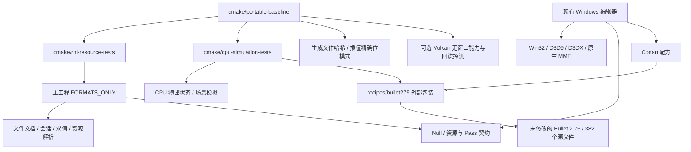

# P0：跨平台基线与构建收敛

日期：2026-11-01。实施计划见 [cross_platform_plan.md](../cross_platform_plan.md)。

本阶段建立可运行、可重复、能报告缺口的基础门禁。它不等同于 macOS／Linux 编辑器已经可用；模型运行时提取、窗口、媒体和去 D3DX 的 MME 前端仍按 P1～P7 推进。

## 1. 构建边界与依赖



资源测试通过 `add_subdirectory` 使用主工程的格式库与 RHI 源文件、生成文件和依赖；取消独立维护的 RHI 源文件列表。旧列表漏掉了通用着色器实现，导致此前 Linux 资源 CI 链接失败。

CPU 独立入口和 Conan 使用同一份 Bullet 包装。两者都启用 C++17；MSVC 的 `/Zc:alignedNew`、`/fp:precise` 及 x86 `/arch:IA32` 作为公共使用要求传播。非 MSVC 的 `-ffp-contract=off` 同样传播到包含 Bullet 内联代码的消费者。没有改写上游源码、删掉对齐，或改变 `btScalar` 精度。

`bullet_allocation` 已移除对 Win32 错误对话框设置的无条件依赖，三平台执行相同的实际分配与销毁循环。Conan 锁文件同步到新包装修订。

## 2. P0 最低环境决策

| 项目 | 首批固定基线 | 范围和限制 |
|---|---|---|
| Windows | x64，CI `windows-2022`／VS 2022；Win32 作为兼容回归列 | Windows 桌面既有兼容路径保留；Server runner 不代表已验证所有 Windows 桌面版本 |
| macOS | macOS 15、arm64；CI `macos-15` | 首批不承诺 Intel Mac；macOS 14 runner 退役，不能继续作为可维护的 CI 基线 |
| Linux | Ubuntu 22.04、x86_64、GCC 11 起 | 初始 glibc 发行基线为 2.35；Wayland／X11 和安装包属于 P3／P7 |
| C++／CMake | C++17；CMake 3.21 起 | CI 的实际编译器和 CMake 版本写入证据，不使用 CMake 的历史版本兼容开关构建 Bullet |
| Python | Python 3.10 起，基础 CI 固定 3.12 | 只用于构建检查、公开样本和报告；不是新编辑器的运行时依赖 |
| Bullet | 仓库内 2.75，`upstream.json` 锁定源文件 | 独立构建无需 Conan／网络；Conan 与独立构建复用包装 |
| 探测用 Vulkan Headers | CI 固定 `v1.3.296` | 可显式传入其他 SDK 头文件；与运行时解耦 |
| macOS 探测运行时 | 官方 MoltenVK `1.4.2` | 固定归档 SHA-256，仅下载探测所需动态库；尚未作为产品包发行 |

上表固定的是当前开发和验证环境。P3 必须根据实际 Surface、着色器和设备能力完成产品最低系统／驱动验收；P7 再完成干净机器与发行资格验证。没有依据 runner 名称直接宣称完整应用支持所有同代系统。

## 3. 数值与公开文件基线

`tests/portable_baseline.cpp` 复用已有模型样本生成器、生产文件读写和轨道求值实现，输出生成 PMD／PMX／VMD／VPD。固定长度与 SHA-256 存放在 `tests/data/portable_baseline_v1.json`，VMD 包含原始 CP932 名称字节。每次执行都与同一份版本化基线比较，并再次生成检查稳定性，不从当次输出重新定义“期望值”。

浮点检查沿用现有轨道回归中的舍入与负零要求：

| 兼容档位 | 插值 X | Y | Z |
|---|---|---|---|
| x64／arm64 独立 float 运算 | `0x3E051EB8` | `0x80000000` | `0x00000000` |
| MSVC x86 既有兼容路径 | `0x3E051EB9` | `0x80000000` | `0x00000000` |

禁止编译器隐式融合乘加，避免 arm64 FMA 改变已固定的中间舍入；没有放宽 `pmm_scene_evaluation` 或显式裁剪的精确断言。这项策略只约束隐式融合，不禁止未来算法明确需要并单独验证的 FMA。

该基线只覆盖文件和轨道；尚未覆盖的蒙皮／IK／Morph 求值将在 P1／P2 增加。Bullet 目前检查分配、生命周期和稳定模拟行为，尚不宣称不同架构下所有物理轨迹逐位相同。

## 4. 无窗口 GPU 探测与 macOS 路线

`tools/platform_probe.cpp` 独立于现有 Windows Vulkan 加载器，用 `LoadLibrary`／`dlopen` 加载显式指定的运行时。无需窗口、交换链、桌面焦点或 DX9。macOS 直接加载固定的 `libMoltenVK.dylib`，并处理 portability enumeration／subset 扩展。

报告包括：设备／驱动／Vulkan API、软件或硬件设备、当前 RHI 要求的 Vulkan 1.3 特性、时间线信号量、浮点符号零／Inf／NaN 保留、各向异性、附件／采样器上限，以及 RGBA8／RGBA16F 的渲染、采样、线性过滤、混合和传输能力。

它还实际分配图像、内存、回读缓冲和命令资源，完成布局转换、清屏、GPU 提交、Fence 等待、Host 可见性同步和销毁：

- RGBA8：精确检查 `(255, 0, 255, 0)`。
- RGBA16F：直接比较 `(-0.5, 2, 0.25, 1)` 的半精度位模式，保留负值、大于 1 的值及 Alpha，禁止先转 RGBA8。

能力查询和传输成功不能替代着色器、MRT 绘制、过滤、MME 或呈现验证。`rhi13_feature_requirements` 仅汇总当前 RHI 的设备特性前提；不代表现有 RHI 已可在该系统编译或运行。

macOS 首批候选路线固定为 arm64＋MoltenVK。实测 macOS 15.8.2／MoltenVK 1.4.2 的 Apple Paravirtual GPU 完成两种格式的精确回读，当前 RHI 的设备特性前提均报告支持；上限为 8 个颜色附件、256 个分阶段采样图像及 16 个采样器。该结果来自虚拟 GPU，不能替代实体 Mac 的性能、同步和发行资格测试。

据此 P3 先迁移现有 Vulkan 加载器、能力协商、Surface 和编译流程，再验证真实着色器／帧链路，不在 P0 同时引入第二套 Mac 后端。若后续实体设备的严格浮点或其他必要特性无法满足，应实现有证据的能力协商／着色器变体，或评估原生 Metal。不得修改精确回归标准、把缺失能力标成支持。KosmicKrisp 不作为这批 macOS 15 的默认依赖。

## 5. 统一执行与证据

所有命令从仓库根目录执行：

```powershell
# Windows：无需 Conan，基础测试和真实 Vulkan 传输探测均不创建窗口。
python tools/run_portable_baseline.py --build-dir out/p0-local-x64 `
  --generator "Visual Studio 17 2022" --architecture x64 --require-device

# 兼容 x86 检查，不要求机器安装 32 位 Vulkan 运行时。
python tools/run_portable_baseline.py --build-dir out/p0-local-x86 `
  --generator "Visual Studio 17 2022" --architecture Win32
```

```sh
# Linux：先安装编译器、CMake、Python、Vulkan loader／驱动及 Vulkan 头文件。
python3 tools/run_portable_baseline.py --build-dir out/p0 \
  --generator 'Unix Makefiles' --vulkan-include /path/to/Vulkan-Headers/include \
  --require-device

# macOS：使用已安装的 Xcode 命令行工具和 Vulkan-Headers。
python3 tools/fetch_moltenvk_probe.py --output out/moltenvk
python3 tools/run_portable_baseline.py --build-dir out/p0 \
  --generator 'Unix Makefiles' --vulkan-include /path/to/Vulkan-Headers/include \
  --vulkan-library out/moltenvk/libMoltenVK.dylib --require-hardware
```

执行器完成配置、构建、第二次增量构建、两轮完整 CTest，以及可选探测。重复的是整个测试套件，确保 CLI 的一次性输出文件由 setup fixture 重建。`--require-hardware` 要求非 CPU Vulkan 设备实际完成传输，允许 CI 的虚拟 GPU，设备名称保留在报告中；`--require-device` 可接受明确标记的软件 Vulkan；只传 `--probe` 时允许报告缺少运行时，不能以此宣称 GPU 通过。

`out/<build>/evidence/p0-report.json` 包含提交、是否有未提交改动、系统／架构、工具链、上游清单、精确基线、重复测试计数和探测结果；同目录保存各步骤日志与两轮 JUnit。CI 始终上传 `p0-<runner>-<arch>` 工件。基础套件 Windows 有 49 项、Linux／macOS 有 48 项，唯一允许的跳过是缺少外部私有 PMM 样本的 `pmm_scene_session_external`；分配、销毁、公开文件与数值基线不得跳过。

## 6. 现有缺口与 P0 验收记录

| 能力 | Windows | Linux | macOS |
|---|---|---|---|
| 文件／会话与 Null RHI | 本机与 CI x64／x86 各两轮通过 | CI 两轮通过 | CI 两轮通过 |
| Bullet／独立 CPU 状态 | 本机与 CI x64／x86 各两轮通过 | CI 两轮通过 | CI 两轮通过 |
| Vulkan 原始 RGBA8／16F 回读 | 本机 TITAN Xp 通过；托管 CI 缺运行时 | CI llvmpipe 软件驱动通过 | MoltenVK／Apple Paravirtual GPU 通过 |
| 当前完整编辑器 | 既有 Windows 路径 | P1～P4 待迁移 | P1～P4 待迁移 |
| 无 D3DX 的原始 FX9 导入 | P5 待完成 | P5 待完成 | P5 待完成 |
| 完整 Ray／媒体／发行 | 专项兼容范围见现有文档 | P5～P7 | P5～P7 |

已有失败与缺设备必须保留其实际含义：私有 PMM 数据不随仓库公开；远程会话下 DX9 设备可能不可用；Windows 托管 CI 不保证 Vulkan 硬件；Linux 软件驱动不能代替真实独显资格；完整 Ray 不能从生成场景或单个效果通过推断。P0 不启动 DX9 测试或操作桌面来消除这些限制。

实施提交：`6f0416f`（构建／基线／探测）与 `9a0a773`（macOS runner 更新）。首次 P0 CI 中 macOS 14 因 runner 退役演练被取消，保留该基础设施失败记录，改用 macOS 15 后重新验证。

- [三平台 P0 基础 CI](https://github.com/jstzwj/MikuDanceStudio/actions/runs/41217386848)：四列全部通过；每列重复两轮测试，生成文件哈希与对应架构的精确浮点位模式一致。
- [Bullet 回归 CI](https://github.com/jstzwj/MikuDanceStudio/actions/runs/41217288923)：x86／x64 × Debug／Release × CMake 3.21.4／4.0.3，共八列通过。
- [版本化证据摘要](evidence/cross-platform-p0.json)：保存实际系统、工具链、计数和能力数据，避免只依赖有保留期限的 CI 工件。原始日志、生成样本、JUnit 和完整报告仍在 CI 工件中。

Windows 既有应用使用锁定的新 Bullet 修订完成 x64／x86 Release 构建；x64 的分配、模拟、源码完整性、物理容差四项通过，x86 在此基础上额外执行数学回归，共五项通过。构建仅产生产物，未启动编辑器或创建测试窗口。

**P0 已完成。** 三平台基础目标可重复构建，分配与析构检查通过，文件／数值标准未放宽，已有失败和缺设备已明确记录，Mac 路线有实际 Vulkan／Metal 传输证据。下一阶段为 P1 的独立数学边界与最小模型运行时；完整渲染和呈现仍须通过 P3 验收。
