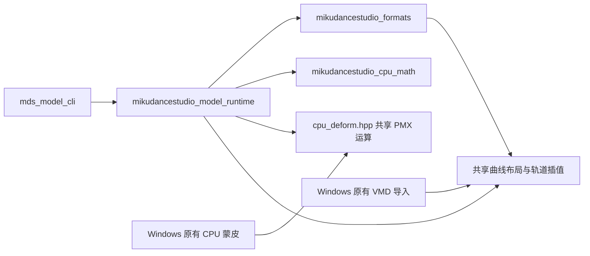

# P1：独立数学与最小模型运行时

日期：2026-11-01。阶段定义见 [跨平台计划](../cross_platform_plan.md)，构建基线见 [P0 记录](CROSS_PLATFORM_P0.md)。

P1 实现从公开生成 PMX／VMD 到骨骼、Morph 和 CPU 顶点快照的无窗口链路。新运行时不持有 `MMDApp`、原版内存布局、窗口、设备或 COM 对象。完整模型求值和编辑器迁移仍分别属于 P2 和后续阶段。

## 1. 模块边界



- `cpu_math.hpp`：行主序矩阵、XYZW 四元数、变换、归一化、转置、乘法和检查过的逆矩阵。
- `cpu_deform.hpp`：从原有 PMX worker 提取的 BDEF 运算和直接顶点 Morph 累积。Windows 原有 worker 实际调用这些函数；x86 BDEF2 继续保留原有 x87 适配器。
- `vmd_bone_interpolation.hpp`：VMD 四个 16 字节通道块到 PMM 曲线布局的转换，Windows 导入与新运行时共用。
- `ModelResource`：深拷贝已解析模型，保存不可变文档、名称与拓扑顺序。
- `MotionClip`：绑定指定资源的轨道；保留资源所有权，避免骨骼／Morph 索引被另一份模型复用。
- `ModelInstance`：保存当前 Clip 和已发布快照。求值从不可变绑定姿态恢复，重复／向后 Seek 不累积 Morph 或变换。

资源创建、Clip 创建、绑定或 Seek 失败时保留原对象／已发布状态；快照中的矩阵、权重和顶点都是拥有自身存储的值，复制后可以独立于实例生命周期存在。

## 2. 实际支持范围

| 项目 | P1 行为 |
|---|---|
| 模型 | PMX 2.0，沿用生产解析器现有 UTF-16LE 支持边界 |
| 名称 | PMX UTF-16LE 严格解码为 UTF-8；拒绝损坏代理对、空标识和歧义名称 |
| VMD 匹配 | 首批支持 ASCII 轨道名称；原始 CP932 非 ASCII 名称明确报错，转换服务放在 P2 |
| 骨骼 | 普通父子层级，允许文件中子骨骼排在父骨骼之前；拒绝越界引用、自引用和环 |
| 动画 | 非负整数帧 Seek，使用现有 PMM/MMD 骨骼曲线、Seek 四元数插值和 Morph 线性插值 |
| 关键帧规则 | 稳定排序；同帧最后一个输入覆盖此前输入；补绑定姿态的帧 0；末帧后保持末值 |
| 蒙皮 | BDEF1／BDEF2／BDEF4，沿用原版已记录的计算顺序；负骨骼引用贡献零矩阵 |
| Morph | 直接顶点 Morph，按模型顺序累积，在蒙皮之前应用 |
| 输出 | 模型空间的骨骼局部／蒙皮矩阵、骨骼世界位置、轨道姿态、Morph 权重、顶点／法线／UV |
| 未匹配轨道 | 保持原有按名称匹配的意图，输出 `unbound-*-track` 警告，报告中保留被忽略的名称 |
| 材质／纹理 | 作为文档元数据保留；P1 不进行渲染或材质求值 |

以下能力在资源或 Clip 创建时拒绝，即使当前帧暂时没有启用它们：IK、SDEF、QDEF、继承／固定轴／外部亲／物理相关骨骼、刚体／关节、附加 UV、骨骼／组／UV／材质 Morph、全局相机／灯光／阴影／IK 轨道及物理切换关键帧。PMD 运行时、CP932 名称解码、物理播放、MME 和呈现列入 `unsupported`。

非法权重、非有限数值、非单位旋转、损坏引用和超出有符号帧范围的输入也会拒绝，不通过替换为零或遗漏求值掩盖失败。支持／未支持列表由运行时头文件定义，可使用 `--capabilities` 查询。上述限制限定首条垂直链路，不能据此声明真实复杂模型已经完整移植。

## 3. 数学与兼容契约

CPU 模型空间沿用 MMD／D3DX 的左手约定、行向量和行主序存储：`p' = p * M`，平移位于索引 12～14，层级组合为 `local * parentSkin`。骨骼局部矩阵沿用原有的绝对绑定位置夹心顺序：

```text
local = T(-rest) * RotationQuaternion(q) * T(offset) * T(rest)
skin  = local * parentSkin
worldPosition = rest * skin
```

方向变换不应用平移，蒙皮后不额外归一化法线。四元数为 XYZW；通用 `HamiltonProduct(a,b)` 明确定义为 Hamilton 的 `a*b`，与 D3DX 接口的反向参数次序区分。`RotationQuaternion` 沿用 D3DX 不自动归一化的行为；运行时在输入边界检查单位旋转。

普通矩阵和变形使用 float 存储与固定表达式顺序，禁止隐式 FMA。归一化与通用逆矩阵使用 double 中间值来检查零长度、非有限值、奇异和溢出；失败不修改输出。逆矩阵不宣称与 D3DX 逐位一致。

复核补修：逆矩阵使用按行尺度选择的主元，主元与原行尺度的比值不大于 `64 * double epsilon` 时拒绝；不能只检查主元是否精确等于零。写成 float 后，在 double 中计算 `A * inverse` 和 `inverse * A`，任一分量对单位阵的绝对残差超过 `2e-5` 也拒绝。此边界可能拒绝数值不稳定的可逆输入，失败保持原输出，包括输入／输出别名的情况。回归包含非零线性相关行、不同尺度的奇异输入、极小／极大／非均匀缩放、仍可精确表示逆矩阵的近奇异输入、float 存储丢失精度及逆矩阵溢出。

Windows 原有 x86 兼容数学保持原样；新链路复用现有轨道插值的架构分支。矩阵／三角函数与骨骼组合不承诺跨架构逐位相同。数值门禁为每个分量：

```text
abs(actual - reference) <= 2e-5 * max(1, abs(reference))
```

绑定姿态、生成文件哈希、同一进程的重复 Seek、独立进程重复输出使用严格比较。P0 原有的负零、浮点位模式和文件字节门禁保持原标准；这里的数值阈值不修改这些检查，也不替代图像比较。

## 4. 公开生成输入与 CLI

生成器不依赖任何外部模型、贴图、MMD 安装目录或图形设备。PMX 包含四根骨骼、六个顶点、两组直接 Morph、BDEF1／2／4、负骨骼引用和逆序父子记录；VMD 包含乱序与重复关键帧、非线性位置曲线、旋转以及 Morph 动画。

```powershell
cmake -S cmake/portable-baseline -B out/p1 -G "Visual Studio 17 2022" -A x64
cmake --build out/p1 --config Release --target mds_model_cli model_runtime_test cpu_math_test
python tools/generate_p1_fixture.py --output out/p1-input
out/p1/resources/portable/Release/mds_model_cli.exe `
  --model out/p1-input/public.pmx --motion out/p1-input/public.vmd `
  --frame 0 --frame 4 --frame 8 --frame 12 --output out/p1-input/snapshots.json
```

Linux／macOS 可以使用相同 CMake 入口和 `Unix Makefiles`；单配置 CLI 路径为 `out/p1/resources/portable/mds_model_cli`。生成器和 CLI 参数相同。完整基础门禁可直接执行：

```sh
python3 tools/run_portable_baseline.py --build-dir out/p1 --generator 'Unix Makefiles'
```

这是 CPU 链路，不需要 Conan、D3DX 或 Vulkan SDK。探测 GPU 是沿用 P0 执行器的可选能力，只有指定探测参数才启用。

CLI 使用原生文件系统路径；Windows CRT 的宽参数入口转换为 UTF-8 后再通过 `std::filesystem` 打开文件。测试将输入放到含中文和日文的目录。现有 VMD 解析器的 `FILE*` 接口通过二进制临时流适配，不把 Unicode 路径交给系统 ACP。

无效输入会返回非零退出码，并在 stderr 输出诊断；所有请求帧求值成功后才生成输出，因此后续帧失败不会发布部分成功快照。

## 5. 回归与独立对照

| 检查 | 证据 |
|---|---|
| 通用数学 | 行列／乘法顺序、平移与方向、枢轴、逆矩阵与归一化失败、四元数乘法及变形顺序 |
| 资源与实例 | 源文档修改隔离、多实例、乱序层级、向前／向后／重复 Seek、快照释放、资源身份及非法能力拒绝 |
| 完整 CLI | 同一输入的 0／4／8／12／4／0／8 帧，独立进程重跑，固定公开输入哈希和版本化骨骼／顶点基准 |
| CLI 失败 | 截断 PMX、截断 VMD、负帧、已成功帧后跟非法帧，均不生成结果文件 |
| 依赖审计 | CMake 目标依赖、项目头文件闭包、PE 导入／`ldd`／`otool -L`，拒绝 UI、GPU、COM 和原版布局依赖 |
| Windows 独立数学对照 | 64 组矩阵／四元数与真实 D3DX CPU 导出比较，无窗口或设备 |
| Windows 原有 CPU 路径 | 六次 Seek 的局部／层级矩阵与 D3DX 夹心组合比较，顶点与实际 PMX Morph／BDEF worker 比较 |
| 既有兼容回归 | PMD 并行蒙皮、PMX CPU 几何、VMD 解码与导入适配器 |

`model_runtime_native_test` 直接调用原有 CPU worker，不进入旧模型加载器、`MMDApp` 或弹窗错误路径。Windows x64／x86 都已完成该对照。共享轨道核保持同源，D3DX 负责独立验证矩阵组合；原有几何测试继续验证 worker 的已有行为。

该对照以新运行时求出的平移、旋转与 Morph 权重为输入，属于矩阵／变形模块级对照，不代表旧 Windows 加载、关键帧注册及姿态求值全链路已经独立验证；后者随 P2 完整运行时迁移扩展。

版本化数值基准位于 `tests/data/p1_model_v1.json`，来源为经过上述 Windows 独立路径验证的公开输入快照。CI 对同一基准比较，不自动根据当前平台更新期望值。

三平台基础执行器继续生成 `evidence/p0-report.json`，其阶段字段扩展为 `P0+P1`，并包含 `model_runtime`／`model_dependencies`。P1 工件另有 `p1-report.json`、`snapshots.json`、依赖清单、公开 PMX／VMD，以及原有的两轮 JUnit 和构建日志。唯一允许跳过的仍是仓库外私有 PMM 样本；P1 四项门禁必须实际执行。

## 6. 阶段验收

实现分为数学与 Windows 共享函数、独立资源／实例、CLI 与三平台门禁三个提交：`26b3dad`、`f1eee29`、`d2f7490`。

**P1 已完成。** 验收证据如下：

- [三平台完整基础 CI](https://github.com/jstzwj/MikuDanceStudio/actions/runs/41219770957)：Windows x64／x86 各两轮 53 项，Ubuntu 22.04／macOS 15 arm64 各两轮 52 项；每列仅跳过既有私有 PMM 外部样本测试。
- 四列 P1 快照与版本化数值基准的最大绝对差异均为 0；P1 四项门禁均实际执行，依赖审计通过。
- [Bullet 回归 CI](https://github.com/jstzwj/MikuDanceStudio/actions/runs/41219770975)：八列配置全部通过。
- Windows x64／x86 Release 编辑器构建通过；本机 x64 七项、x86 六项相关 CPU 回归通过，包含 D3DX 独立数学、原有 PMX worker、VMD 解码及导入。x64 额外运行其原有 PMD OpenMP 蒙皮回归。
- [版本化验收摘要](evidence/cross-platform-p1.json) 保存提交、系统、工具链、计数、最大差异、能力范围和实际二进制依赖；原始日志、两轮 JUnit 和生成快照保留在 CI 工件中。

下一阶段为 P2：先完成 CP932 名称服务、扩大骨骼／Morph／蒙皮支持，再提取 IK 与物理调度，逐步将 Windows 完整 CPU 路径迁入同一运行时。完整应用和任意真实模型的兼容性仍按其对应退出条件验收。
